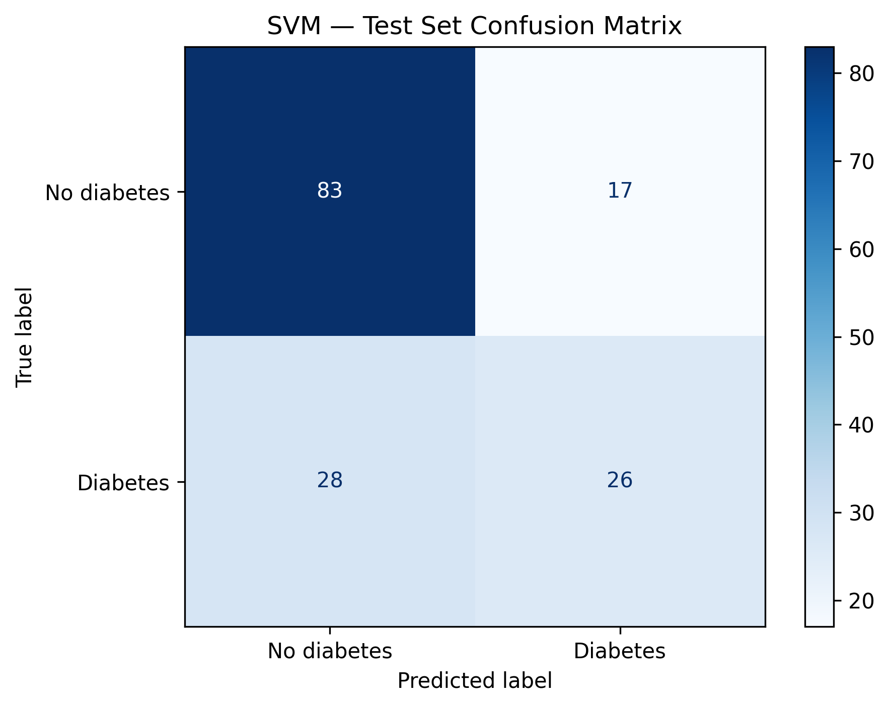

# Diabetes Prediction using SVM

## Overview
An educational machine learning project that classifies diabetes
outcomes using the PIMA Indians Diabetes dataset.

## Dataset
- 768 records
- 8 input features and 1 target column (Outcome)
- Outcome: 0 = No diabetes, 1 = Diabetes
- Source: https://github.com/jbrownlee/Datasets

## Method
1. Replace invalid zero measurements with missing values.
2. Split data into 80% training and 20% testing.
3. Fill missing values using median imputation.
4. Standardize features using StandardScaler.
5. Train a linear Support Vector Machine.
6. Tune C using five-fold cross-validation on training data.

Imputation and scaling are inside the pipeline to prevent data leakage.

## Results
- Training accuracy: 78.18%
- Testing accuracy: 70.78%
- Precision: 60.47%
- Recall / Sensitivity: 48.15%
- Best C: 0.1

## Files
- Diabetes_Prediction_SVM.ipynb: Executed project notebook
- diabetes.csv: Original dataset with column names
- dataset_sample.csv: Sample after invalid zeros are marked missing
- diabetes_svm_model.joblib: Trained preprocessing and SVM pipeline
- confusion_matrix.png: Test-set evaluation chart
- requirements.txt: Python dependencies

## How to Run
Open Diabetes_Prediction_SVM.ipynb in Google Colab and run
the cells from top to bottom. Internet access is required
to load the dataset.

For local use, install dependencies with:
pip install -r requirements.txt

Use the predict_diabetes() function in the notebook to try example inputs.

## Limitations
Performance is measured on one held-out dataset split.
Results may not generalize to other populations.
This project is for educational use, not medical diagnosis.
